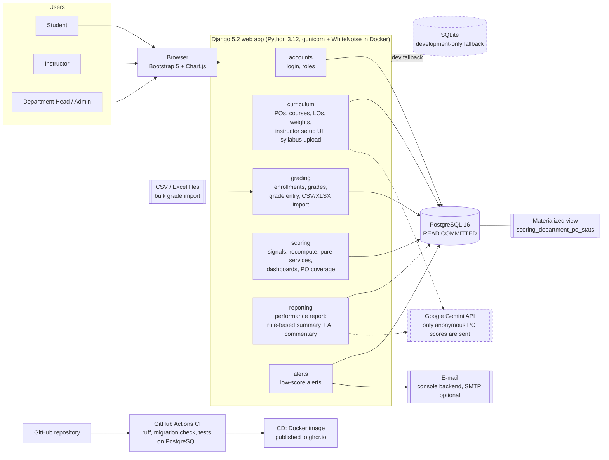
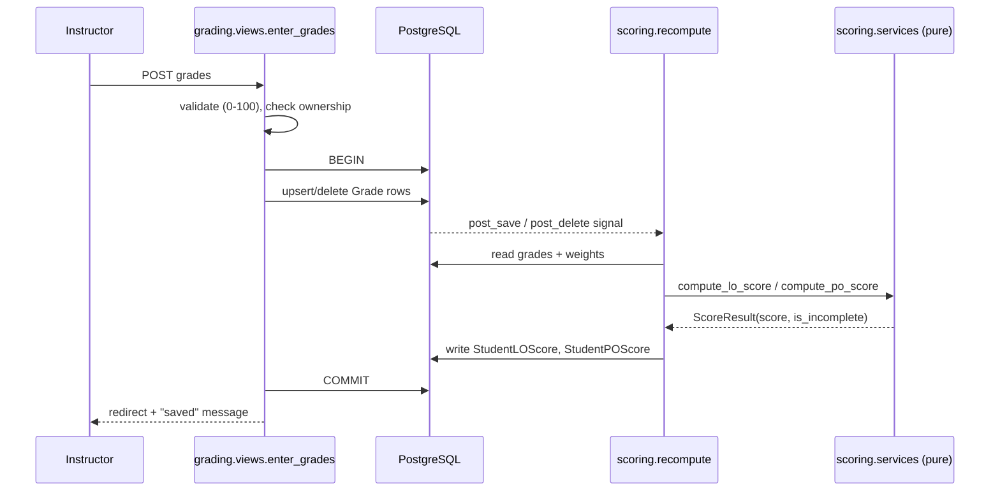

# System architecture

Solid boxes are part of the running system. Dashed boxes are development-only or optional.

## Request flow: an instructor saves grades

## Layers

| Layer | Where | Rule |
|---|---|---|
| Presentation | `templates/`, views | Role checks on the server (`accounts.permissions.role_required`) |
| Domain logic | `scoring/services.py` | Pure Python, no Django, unit-tested |
| Orchestration | `scoring/recompute.py`, `scoring/signals.py` | Reads DB, calls the service, stores cached scores, always inside `transaction.atomic` |
| Persistence | models + migrations | Constraints enforced in the DB, not only in forms; the department averages come from a materialized view |

## Notifications (low-score alerts)

The `alerts` app e-mails a student when a PO score is below the threshold (`reporting.rules.LOW_SCORE_THRESHOLD`, 60).
`alerts.services.sync_alerts()` keeps one `POAlert` row per student and PO in step with the cached scores, and
`send_pending_alerts()` sends one message per student for the alerts not yet mailed (`emailed_at` empty). It runs from
`manage.py send_alerts` (what a scheduled job would call) or the "Send low-score alerts" button on the department
dashboard. E-mail is deliberately not sent from signals or the recompute (see `docs/design-decisions.md`).
By default Django's console backend prints the message in the terminal; real SMTP is chosen with the `EMAIL_*`
environment variables (see `.env.example`).

## AI commentary and syllabus upload

`reporting` (performance report commentary) and `curriculum.syllabus` (syllabus upload) call the Google Gemini API
(`GEMINI_API_KEY`, `GEMINI_MODEL`). Only anonymous PO scores are sent, never names or student numbers. Without a key
the report still has its rule-based summary.

## Delivery

GitHub Actions CI runs ruff, a migration check and the test suite on PostgreSQL. After CI passes on `main`, the CD
workflow builds the Docker image (gunicorn + WhiteNoise) and publishes it to ghcr.io. There is no deployed production
server; migrations are run on purpose by whoever starts the container.
