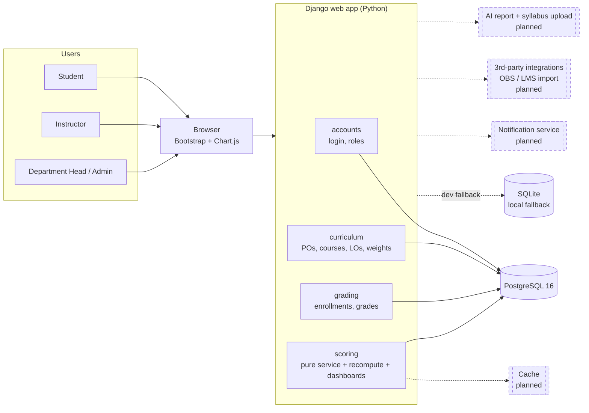
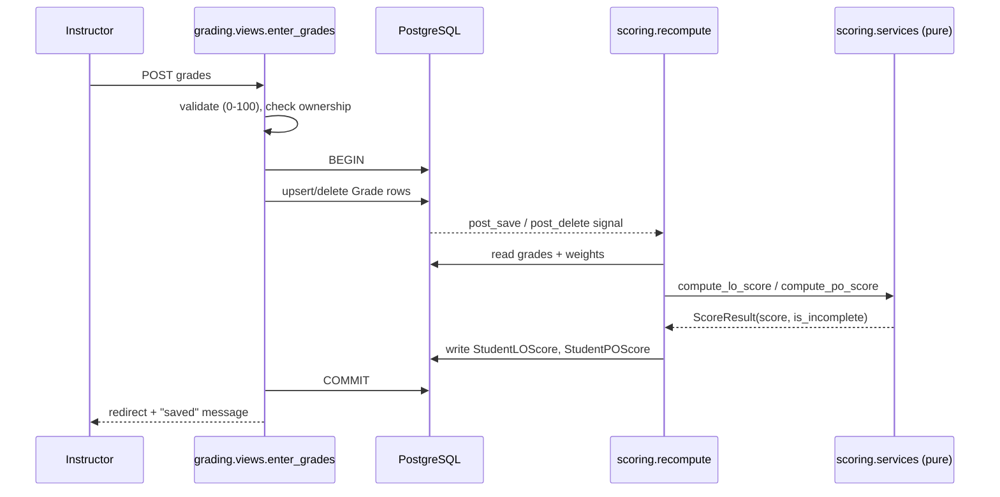

# System architecture

Solid boxes exist today. Dashed boxes are **planned** (not built yet).

## Request flow: an instructor saves grades

## Layers

| Layer | Where | Rule |
|---|---|---|
| Presentation | `templates/`, views | Role checks on the server (`accounts.permissions.role_required`) |
| Domain logic | `scoring/services.py` | Pure Python, no Django, unit-tested |
| Orchestration | `scoring/recompute.py`, `scoring/signals.py` | Reads DB, calls the service, stores cached scores, always inside `transaction.atomic` |
| Persistence | models + migrations | Constraints enforced in the DB, not only in forms |
