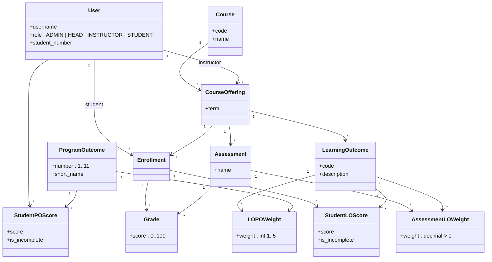
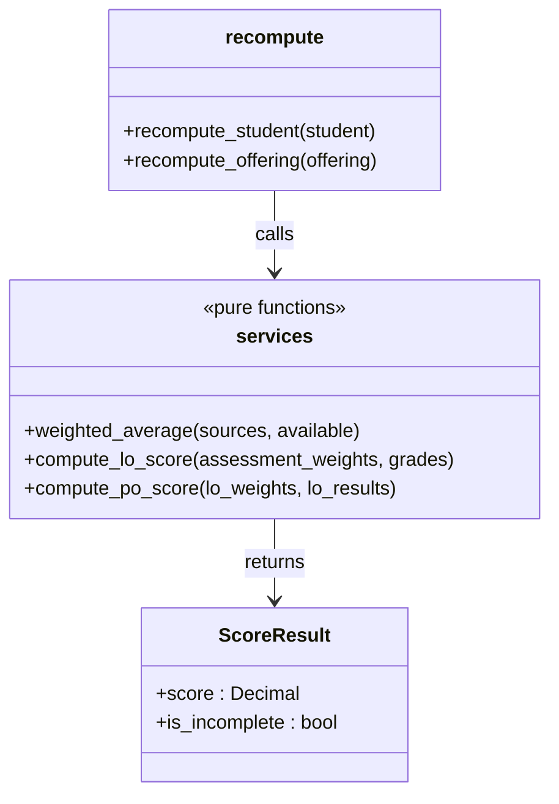

# Class diagram

## Relationships in words

- A **Course** (CSE 311) is taught as many **CourseOfferings** (CSE 311, 2026-Fall, taught by X).
- Learning outcomes, assessments and weights belong to the **offering**, so changing weights next semester never rewrites history.
- `AssessmentLOWeight` and `LOPOWeight` are association classes that carry the weights.
- `Enrollment` ties a student to an offering; `Grade` is one score on one assessment.
- `StudentLOScore` and `StudentPOScore` are cached results (see `data-model.md`).

## Scoring code (not a model)

