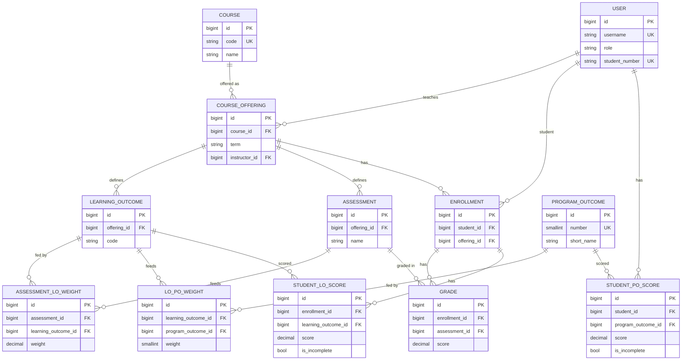

# Data model



## Tables

| Table | Purpose | Constraints and indexes |
|---|---|---|
| `accounts_user` | Login + role | `username` unique, `student_number` unique |
| `curriculum_programoutcome` | The 11 department POs | `number` unique |
| `curriculum_course` | Catalogue entry (CSE 311) | `code` unique |
| `curriculum_courseoffering` | Course in a term, with its instructor | unique (course, term) |
| `curriculum_learningoutcome` | LO of one offering | unique (offering, code) |
| `curriculum_assessment` | Midterm, project, ... of one offering | unique (offering, name) |
| `curriculum_assessmentloweight` | Assessment -> LO weight | unique (assessment, LO); CHECK weight > 0 |
| `curriculum_lopoweight` | LO -> PO weight | unique (LO, PO); CHECK weight BETWEEN 1 AND 5 |
| `grading_enrollment` | Student in an offering | unique (student, offering) |
| `grading_grade` | One score on one assessment | unique (enrollment, assessment); CHECK 0 <= score <= 100; FK indexes on `assessment_id` and `enrollment_id` (created by Django) |
| `scoring_studentloscore` | **Cached** LO score | unique (enrollment, LO) |
| `scoring_studentposcore` | **Cached** PO score | unique (student, PO); FK index on `program_outcome_id` |

## Normalized vs denormalized

- **Normalized (3NF):** everything in `accounts`, `curriculum` and `grading`. Each fact is stored once: a weight lives in exactly one row, a grade in exactly one row. This is the source of truth.
- **Denormalized on purpose:** `StudentLOScore` and `StudentPOScore`. They are derived values that could be recomputed from grades and weights at any time. We store them so dashboards read one row per student and PO instead of joining and aggregating grades, weights and LOs for every page view.
- **Keeping the cache correct:** signals on `Grade`, `Enrollment`, `AssessmentLOWeight` and `LOPOWeight` call `scoring.recompute`, inside the same transaction as the change. If a score has no sources anymore, its cached row is deleted so stale values never remain.
- **Not a star/snowflake warehouse (yet):** the operational schema is normalized. A star schema with `StudentPOScore` as a fact table is a possible future analytics layer.

## Final row counts and sizes (CSE 321 report)

Fill in at the end of the project, from the production-like database:

```sql
SELECT relname, n_live_tup, pg_size_pretty(pg_total_relation_size(relid))
FROM pg_stat_user_tables ORDER BY relname;
```

## Planned for the final (not built yet)

Index tuning from real query plans, a materialized view for department averages, partitioning of `grading_grade` by term, replication and failure handling.
